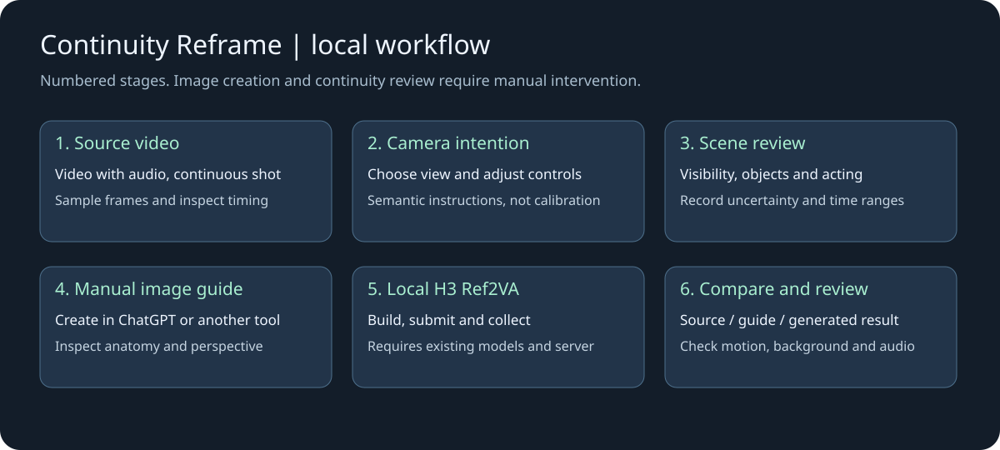
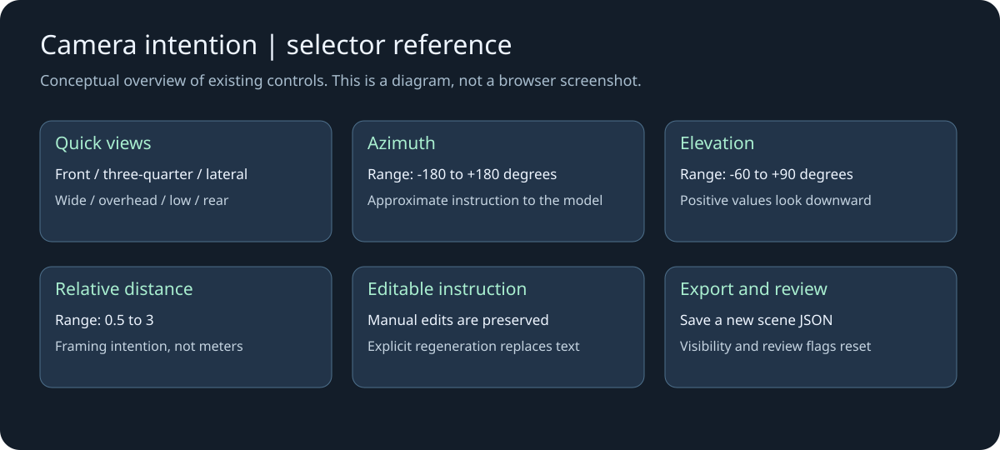
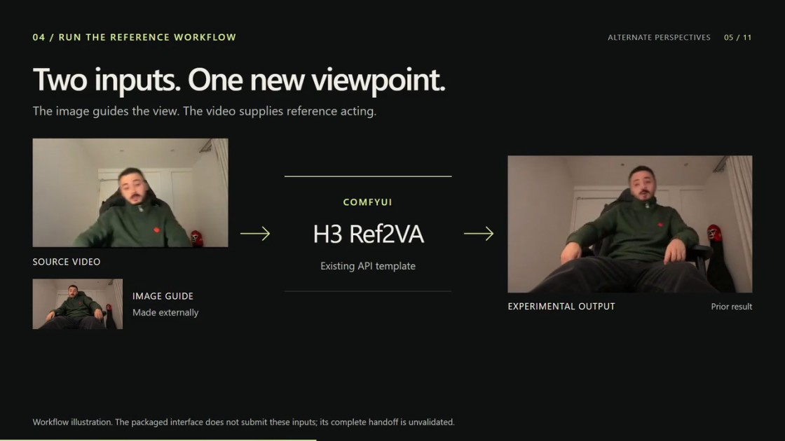
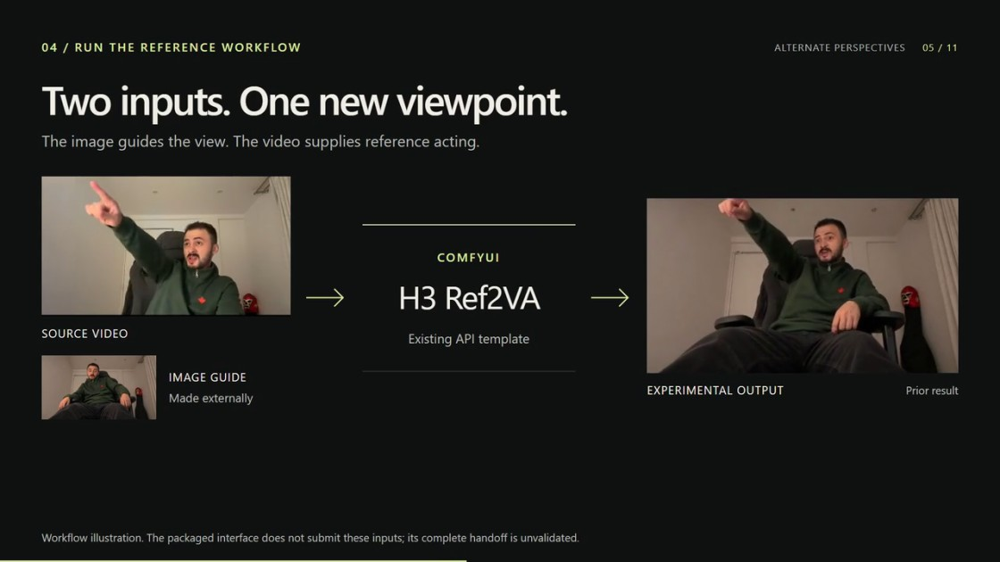

# H3 Camera Reference Kit — MIT release candidate

**Input required:** one continuous video with audio and at least approximately 5.167 seconds available for the default 124-frame selection at 24 fps. Use the exact source interval described in QUICKSTART. A working local ComfyUI server, the four H3 weights, Python with NumPy/OpenCV, and FFmpeg/ffprobe are required before doctor. A complete from-zero setup, including new model/FFmpeg acquisition and interactive UI, has not been validated.

Start with [QUICKSTART.md](QUICKSTART.md) for an existing ComfyUI installation: prerequisites, model placement, server startup, manual guide preparation and an end-to-end command sequence. A complete from-zero setup, including new model/FFmpeg acquisition and interactive UI, has not been validated.

A local, reusable workflow for preparing a video, selecting a target camera intention, inserting a manually generated image guide and running H3 Ref2VA in ComfyUI. This is a published experimental release with the validation limits documented below; project-authored code is licensed under MIT (see LICENSE).

## Installation status: historical GPU build unavailable

The recorded `torch==2.14.0.dev20260705+cu130` is a **historical test environment**, not an installable recommendation. On 2026-11-03, the official CUDA 13.0 nightly index returned `No matching distribution found` for that exact Windows/Python 3.13 wheel. Do not blindly substitute another nightly or modify a working installation to match this record.

**New CLI installation tested:** CPython 3.13.12 from its official NuGet distribution, NumPy 2.4.6 and opencv-python 5.0.0.93 from PyPI. The five kit test suites, five sampler tests, `pip check`, prepare and build passed. Doctor and collection/comparison used an existing server/job; existing FFmpeg was reused. This does not establish a clean H3 server installation.

**Alternative tested on one complete H3 run:** official PyTorch 2.13.0+cu130, torchvision 0.28.0+cu130 and torchaudio 2.11.0+cu130, with ComfyUI 0.34.3 and Python 3.13.12 in a separate package installation. On RTX 5070 Ti, the 124-frame, 800x480, max-reference run took 587.1 seconds from submission to collection. Comparison was created afterward and is not included in that timing. The largest approximately 50-second VRAM sample was 12238 MiB; this is not an exact peak. Attention used PyTorch without SageAttention or Triton. Existing model files, driver and FFmpeg were reused; browser/canvas operation and fresh model acquisition remain untested. See [installation evidence](ISOLATED_ENVIRONMENT_TEST.json) and the [isolated package/setup steps](ALTERNATIVE_INSTALL.md).

## Visual reference





These technical diagrams contain no source footage or private images. Open `camera_picker.html` for the actual interactive selector. Camera controls describe an intention; they do not reconstruct exact scene geometry.

## Frames from the published demo





Frames at 38.000 s and 44.000 s from the owner-authorized [published demo](https://lnkd.in/p/ecCjd26T). These are snapshots of the earlier demonstration, including its original labels and limitations; they are not new benchmark results or proof of exact acting, identity or scene geometry. Only the seated demo is reproduced here. No third-party exterior footage is included. The manual image-generation step remains separate from the local H3 workflow.

## What happens where

1. **CLI:** extract frames, prepare video/audio and create a scene sheet.
2. **Local browser:** choose a quick view and adjust azimuth/elevation/relative distance. The schematic illustrates intent; it does not reconstruct geometry. Edit the visible instruction and download a new sheet.
3. **Human review:** decide object visibility from multiple source frames. Do not move objects into frame to satisfy a prompt. Complete timed actions and record uncertainties.
4. **Manual image tool:** create the reference in ChatGPT, FLUX or another provider. No automatic provider adapter or paid API is included. One locally generated FLUX guide completed H3 inference at800x480 in364.8s. The image was selected and transferred manually; there is no automatic FLUX-to-H3 adapter.
5. **Human review:** check initial posture, anatomy, background perspective, occlusions and full gesture margins. Mark review flags only after inspection; they are assertions, not automatic validation.
6. **ComfyUI local API:** run H3, collect both audio versions and build a synchronized comparison. Final visual/acting review remains manual.

## Existing requirements

Use an existing compatible ComfyUI installation with the four weights named in `workflow.template.api.json`, Python with NumPy/OpenCV, and FFmpeg/ffprobe on PATH. Owner-authorized illustrative demo stills are included. No executable example videos, standalone generation guides, binaries, models, credentials or installer are bundled. Start or reuse the active local server before running doctor; doctor also requires this Python environment and FFmpeg/ffprobe. Run doctor before inference. See `DEPENDENCY_NOTICES.en.md` for exact observed versions and upstream terms.

## Run with your own authorized footage

Use new filenames/directories every time. Replace COMFY_INPUT/COMFY_OUTPUT with the server's actual directories and use the Python environment that has the dependencies.

```text
python -B cinema.py doctor --out doctor-new.json
python -B cinema.py prepare --video YOUR_VIDEO.mp4 --out project-new --frames 124
```

Open `camera_picker.html` locally. Load `project-new/scene.template.json`, choose frontal/three-quarter/lateral/wide/overhead/low/rear, refine the three controls and optional text, then save a new sheet. Move the downloaded scene-[view]-[timestamp].json into the kit folder under the new filename scene-reviewed.json, or pass its actual path to --scene. Complete visibility/evidence/action timing in that sheet. Generate and inspect `guide.png` manually and save it in the kit folder, or pass its actual path to --guide. Set `reviewed` and `guide_reviewed` true only after review.

```text
python -B cinema.py build --project project-new --scene scene-reviewed.json --guide guide.png --comfy-input COMFY_INPUT --out run-new --width 800 --height 480 --ref-image-size max
python -B cinema.py submit --run run-new
python -B cinema.py collect --run run-new --comfy-output COMFY_OUTPUT --wait 50
```

**Wait for COLLECTED.** If collect prints PENDING, repeat collect; its exit code0 does not mean the video is complete. Only after COLLECTED and both videos are present, run this separate command:

```text
python -B cinema.py compare --run run-new
```

Repeat collect while PENDING. Do not repeat submit after an uncertain connection: inspect queue/history and the recorded client ID first. The script refuses repeated submissions and existing output directories, and retains partial failures. It does not control third-party server/plugin cleanup behavior.

The original reference is copied unchanged to a separate LoadImage node; the initial-frame anchor is letterboxed to output size. `--ref-image-size match|max` changes reference conditioning. Output size can change independently of the prepared acting video. If width/height are omitted, prepared dimensions are used; both must be specified together otherwise. Default reference mode is max. This is a conditioning option, not a fidelity guarantee. Larger dimensions consume more time/memory and can alter motion.

Default clip length is124 frames; H3 uses17k+5 at24fps. Earlier90-frame experiments require `--frames 90 --pilot-short` and are below the recommended trained range. Output dimensions must be multiples of32. Start from a tested size; do not assume the GPU's maximum was found.

## Optional ComfyUI camera node

The HTML picker already puts the camera intention in the sheet and H3 prompt. For controls inside ComfyUI too, copy the new `h3_camera_brief` folder into that installation's custom_nodes directory and restart only when idle. Do not overwrite an existing folder. No pip install is needed; restricted launchers must whitelist the node. This package does not install it automatically.

```text
python -B attach_camera.py --run run-new --out run-with-controls-passthrough
```

These are alternative examples; choose one. They use different new output directories so they cannot collide. Use that selected directory for subsequent submit/collect/compare commands. This writes fresh API and visual graphs with the node connected to H3's prompt. Default behavior passes the reviewed prompt through exactly. To append semantic angle instructions after reviewing a matching guide:

```text
python -B attach_camera.py --run run-new --out run-with-controls-custom --use-angle-brief --preset custom --azimuth 35 --elevation 15 --distance 1.25 --notes "Keep the full hand visible" --guide-reviewed
```

Use `custom` for numeric refinements; named presets use fixed values. Azimuth0 is front,+90 is performer-right,180 is rear; positive elevation looks down. Distance is an editorial framing cue, not meters/focal length. Changing controls does not create a matching image. Build with the newly reviewed guide first. Submit/collect/compare the new run using the same CLI in a server where the node is loaded.

## Visual workflows and validation

Import the **built** `workflow.visual.json`, not the API graph or placeholder template. Refresh the browser's node/media lists after staging inputs. Unique flat filenames avoid loader dropdowns missing files in subdirectories. Image/video/audio dynamic references and both VAEs are explicitly linked and structurally checked against the API graph.

The optional camera node completed real H3 generation with controls enabled at640x384 and800x480. Both800x480 and960x576 completed successfully. See the measured-results table below and VALIDATION_RESULTS.json for earlier runs. Full end-to-end rendering was through the actual ComfyUI API. Interactive browser/canvas acceptance is still pending because computer-use tools were unavailable; HTML control logic and exported sheets were checked with a DOM harness. Do not advertise an accepted one-click browser experience.

## Known limits and honest demo

Higher resolution improved some facial detail in seated and bridge tests, but did not fix a cropped pointing hand or the bridge mechanical arm's missing lowering action. Expression, head pose and hidden background can change. Stable composition does not prove correct geometry, exact acting or identity. Review synchronized source/guide/output and the original-size crops; no face restoration or biometric scoring is used.

Source must have audio. prepare reencodes to AAC and extracts WAV. Comparisons packet-copy prepared AAC and verify its hash, not the complete original recording; this is not lip-sync validation. Source-frame labels assume constant frame rate; exact VFR mapping and rotation-metadata handling are not validated. No automatic scene understanding, 3D reconstruction, retries, image provider calls or publishing.

For a private demo: show the scene sheet and camera intent, manual image boundary, linked workflow, then one successful viewpoint and one concrete acting/framing failure. Illustrative stills from the owner-authorized published seated demo are included above. Executable source videos and standalone generation guides for the seated, bridge and laboratory tests are not bundled. This authorization does not establish publication rights for other private footage. H3 territorial restrictions and third-party material terms still apply.

## Tests and release status

```text
node tests/test_manual_text.cjs
node tests/test_current_controls.cjs
python -B test_resume_review.py
python -B test_symlink_collect.py
python -B test_contracts.py
python -B test_final_options.py
python -B test_compare_pending.py
python -B portable_skill/comfyui-reframe-continuity/scripts/test_sample_video.py
```

Tests create new retained temporary folders; nothing is deleted. Set TEMP/TMP to a writable directory if the environment redirects them. A packaging allowlist and text-pattern audit exclude media, weights, personal absolute paths and credential patterns; generated project folders require their own audit before sharing.

The owner authorized MIT for this project code; see LICENSE. This repository is publicly available as an experimental release. The owner has published the demo linked above and authorized its illustrative stills here. Contest form submission and acceptance are not established by this release. Documentation does not grant model or footage rights.

## Tested machine and measured results

H3 video inference environment: Windows; NVIDIA GeForce RTX 5070 Ti 16 GB (16303MiB reported). Python 3.13.12, NumPy 2.4.6, OpenCV 5.0.0, FFmpeg/ffprobe 8.1.1, ComfyUI 0.34.3, frontend 1.49.6. Node.js 24.14.0 was used only for offline selector regression tests, not inference. These are observed versions, not a universal compatibility guarantee. CPU, account names, machine identifiers, local paths and private footage are omitted.

H3 Ref2VA NVFP4,90frames/24fps (3.75s),20steps,seed18840101. `max` keeps the original guide separate from the output-sized frame-zero anchor. VRAM below is sampled global GPU usage every5s, not an exact allocator peak. Times are submission-to-history, include overhead, and differ in cache state; these are individual observations, not a benchmark.

| Test | Output | Reference | Seconds | Peak observed MiB |
| --- | --- | --- | ---: | ---: |
| Seated, ChatGPT guide | 640x384 | match | 344.3 | 12902 |
| Seated, ChatGPT guide | 640x384 | max | 344.4 | 12406 |
| Seated, ChatGPT guide | 800x480 | max | 375.0 | 12433 |
| Seated, ChatGPT guide | 960x576 | max | 390.3 | 12427 |
| Bridge, manual guide | 800x480 | max | 359.4 | 12638 |
| Seated, local FLUX guide | 800x480 | max | 364.8 | 12711 |

800x480/max is the documented starting point.960x576 is the highest tested size, not the GPU limit or a guaranteed improvement. Some facial detail improved over earlier low-resolution outputs;960 was softer in some moving-face samples and did not fix hand clipping. The FLUX guide provided more pointing-hand margin at3.00-3.21s, but initial hand pose, facial expression and background details differed. The bridge mechanical-arm action remained wrong despite higher detail. None establishes exact acting, identity, lip sync or hidden geometry.

The local FLUX trial used FLUX 3 Image Klein distilled INT8ConvRot, Qwen3 VL 4B INT8 and FLUX 2 VAE;16steps,CFG1,Euler/simple,seed20261103,1024x576 image. Image generation took78.25s with12105MiB sampled peak, separately from H3. This specific manual handoff was tested; a general provider-quality ranking was not.

## Official API and2K: documented, not tested here

The official [MiniMax video-generation V2 documentation](https://platform.minimax.io/docs/api-reference/video-generation-v2-create), checked2026-11-03, documents multimodal/reference-to-video generation with output up to2K through its pay-as-you-go API. The [regeneration endpoint](https://platform.minimax.io/docs/api-reference/video-generation-v2-regeneration) describes converting qualifying H3 768P outputs to2K. Reference-image and reference-video roles can be combined, but the API forbids mixing reference roles with first_frame/last_frame. Thus the local frame-zero-guide wiring cannot be assumed to map directly to the API. The [official H3 architecture](https://github.com/MiniMax-AI/MiniMax-H3#h3-regenerate-2k) describes context processing, base generation and2K regeneration; do not characterize hosted2K as a demonstrated single native base pass. These are possible future integrations. This package contains neither integration and made no paid API call. We have not measured whether either improves these particular shots, acting or identity; do not describe2K/API quality as demonstrated by this local test.

## Selector and collection safeguards

Edited instructions survive control/preset changes. Regeneration requires explicit confirmation before replacing manual text. Saved camera_controls_match_instruction compares the actual text with a newly derived instruction from the current controls; an old instruction is not marked current merely because it once was generated. Numeric parameters remain semantic intent, never a geometric calibration.

Both review flags require literal JSON true. Collection can resume after one output was copied: it reuses existing regular files only after a matching SHA256, rejects different contents and symbolic-link destinations, and never overwrites them. A partial file with differing bytes needs inspection and a separately chosen new destination; it is not automatically repaired.

## Publication status and licenses

Published as an experimental release; validation limitations remain. The owner authorized MIT for project-authored code; see LICENSE. No model or footage license is replaced by it. Model and footage rights are separate. The [H3 Community License](https://huggingface.co/MiniMaxAI/MiniMax-H3/raw/main/LICENSE) excludes the EU, UK, Republic of Korea and USA from its applicable territory; verify applicable authorization and distribution terms. The FLUX weights use their own [FLUX Kommunity License](https://huggingface.co/black-forest-labs/flux-3-image-klein/blob/main/LICENSE.md), not the inference-code license. No weights, private media, credentials or personal paths are bundled. Public example rights are not established by a successful private test.

Final inventories and regression evidence are in INVENTORY_27.json and RELEASE_VALIDATION_23.json. Interactive browser/canvas acceptance remains pending. Prior standalone reports are historical evidence rather than a new acceptance claim.

## Checkpoint provenance and separate image runtime

See MODEL_PROVENANCE.md, WEIGHT_PROVENANCE.json and RUNTIME_PROVENANCE.json. Seven locally hashed files match size and SHA256 published by verified repository metadata: four H3 dependencies and three files used by the separate FLUX experiment. Revisions are pinned, not inferred from filenames. This verifies equivalent published bytes; it does not prove the original download route, reproduce the quantization process, grant redistribution rights or establish a clean-install reproduction.

The H3 diffusion file matches the Abiray collection, with a different filename capitalization locally. Do not substitute another same-named NVFP4 file: one checked alternative has a different size/hash. The tested local diffusion file contains66 trailing bytes beyond its declared tensor data, also present in the matching published artifact. It was not modified. Compatibility with a different loader must be verified rather than silently truncating it.

FLUX image generation used a separate existing environment: Python3.11.9, PyTorch2.13.0+cu130, ComfyUI0.41.0, frontend1.55.17, Transformers5.20.0, comfy-kitchen0.2.37. H3 used Python3.13.12, PyTorch2.14.0.dev20260705+cu130, ComfyUI0.34.3, frontend1.49.6, Transformers5.13.0, comfy-kitchen0.2.31, SageAttention2.2.0. NumPy2.4.6 was present in both. The image-to-video handoff was manual; neither environment was freshly installed for this release review.

GPU: RTX5070Ti16GB, driver610.88 observed during provenance inspection,16303MiB reported. System RAM approximately64GB. No CPU serial, account, machine identifier or personal path is disclosed. Full runtime commit IDs, native H3 node hash, observed loader settings and evidence limits are recorded separately. H3 launch disabled automatic temporary cleanup in memory and used an audit hook to preserve files; these safeguards are not a stock ComfyUI setting. No weights were copied, changed, uploaded or bundled for this audit.

INVENTORY_27.json is the current package inventory. Project-authored code is MIT licensed; see LICENSE. Browser/canvas interactive acceptance remains unverified.

## Storage and optional FLUX access

The four H3 weights total approximately34.03GB (decimal); the three optional FLUX image weights add approximately11.02GB. Allow additional space for the Python/ComfyUI environments, download staging, temporary files and output videos. FLUX is not required when supplying an already created guide.

FLUX downloads may require Hugging Face login and explicit acceptance/access approval on the official repository. Anonymous download requests may return401 even when an artifact exists; that is not evidence of a hash mismatch. No credentials, access acceptance or automatic download are included. Follow the distributor's normal access flow only if you elect to use FLUX.

The H3 artifact's published capitalization differs from the expected lowercase filename in the table. Make a new correctly named copy from the downloaded original. On a case-insensitive filesystem, if the alternate capitalization already occupies the destination, do not overwrite it: use a fresh configured model-search directory and copy the expected name there. Verify the server lists the exact expected name before build. Existing originals remain untouched.

SageAttention 2.2.0 describes the existing tested environment. Its release artifacts are distributed through the upstream [GitHub releases](https://github.com/thu-ml/SageAttention/releases); do not assume that `pip install sageattention==2.2.0` from PyPI reproduces that environment. This kit does not install it or certify a clean setup.
